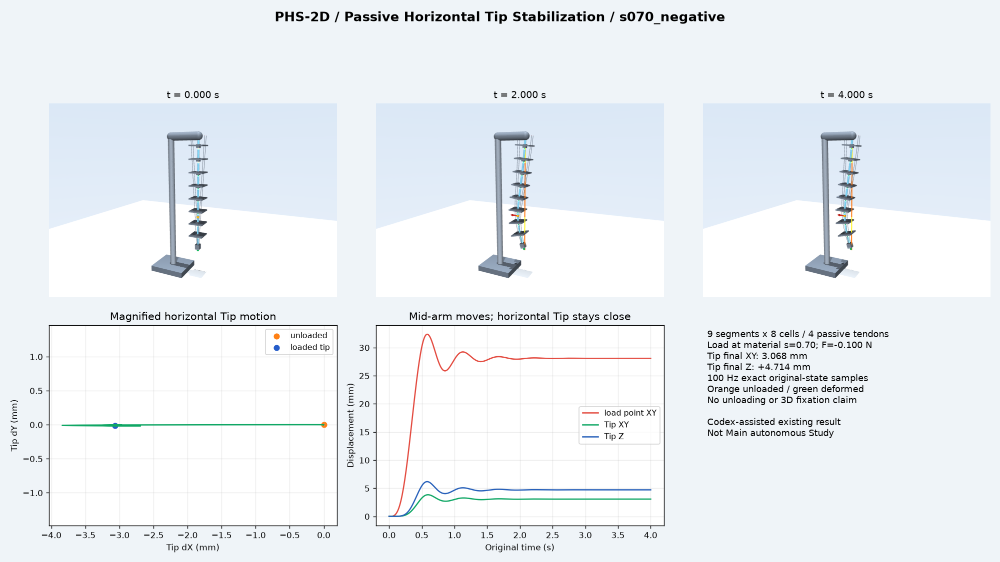
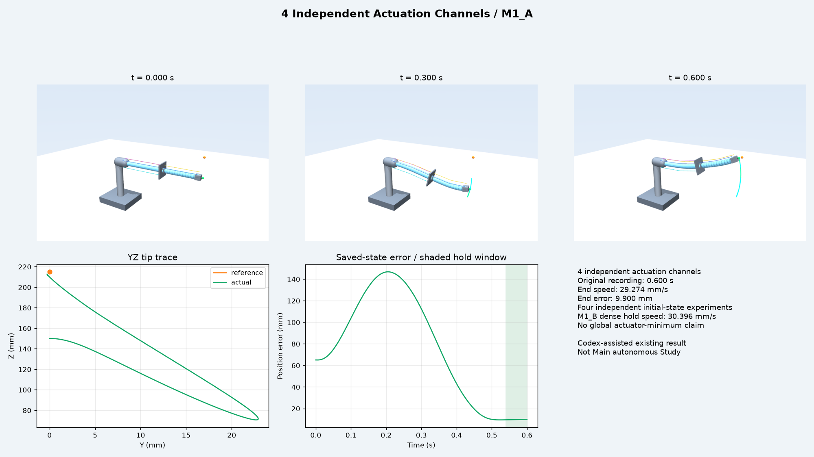
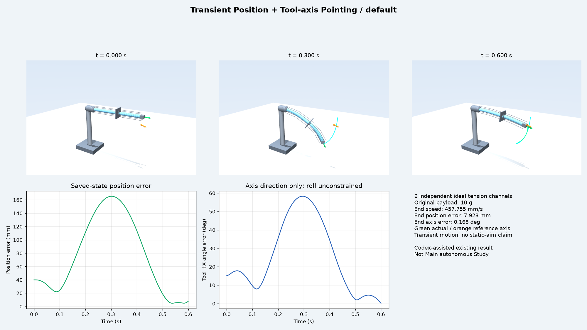

# Softrobot Demo Showcase v2

统一 MuJoCo 保存状态展示：保留 v1 的 M1、Figure-eight、P3，新增 M2–M6、C1、PHS-2D。所有任务来自 **Codex 辅助调用工具完成的工程设计或已有实验**，均不归为 Softrobot-Agent Main 自主 Study。

v2 仅复制已有结果、采样和渲染，没有设计搜索、数学优化、新物理积分或 Main/Reporter/Provider 调用。原成果目录与生产源码保持只读，上一轮分支保持在 `acca7c76ecbbdefa0810fac2cf526af62c1958a6`。

## 环境与启动

Python 3.11+、MuJoCo 3.13.0 和可用 OpenGL；依赖见 `requirements.txt`。当前 Windows 工作区已经安装独立 `.venv`。

```powershell
cd D:\softrobot-demo-showcase
# 新机器首次安装
python -m venv .venv
.\.venv\Scripts\python.exe -m pip install -r requirements.txt
```

每个任务一条启动命令。短时主动任务建议 0.2 倍速；画面始终显示原始实验时间。

```powershell
.\.venv\Scripts\python.exe .\viewer\showcase.py m1 --case central_high --speed .2
.\.venv\Scripts\python.exe .\viewer\showcase.py eight
.\.venv\Scripts\python.exe .\viewer\showcase.py p3 --case plus_x

.\.venv\Scripts\python.exe .\viewer\showcase.py m2 --case positive --speed .2
.\.venv\Scripts\python.exe .\viewer\showcase.py m3 --speed .2
.\.venv\Scripts\python.exe .\viewer\showcase.py m4 --speed .2
.\.venv\Scripts\python.exe .\viewer\showcase.py m5 --speed .2
.\.venv\Scripts\python.exe .\viewer\showcase.py m6 --speed .2
.\.venv\Scripts\python.exe .\viewer\showcase.py c1 --case M1_A --speed .2
.\.venv\Scripts\python.exe .\viewer\showcase.py phs --case s050_positive
```

也可用 `./scripts/run_demo.ps1 -Demo phs -Case s050_negative`；支持 `-Speed`、`-Loop`、`-Technical`。所有命令以脚本目录定位数据，不依赖当前工作目录或原成果目录。`--list-cases` 列出可用工况；选择 `--case` 后单独启动该实验，不把独立初态实验拼接。

| 任务 | 可选工况 |
|---|---|
| M1 | central_high / positive_high / negative_low |
| M2 | zero / positive / negative |
| M3–M6 | default |
| C1 | M1_A / M1_B / M1_C / M5 |
| P3 | plus_x / minus_x |
| PHS | s030/s040/s050/s060/s070 的 positive、negative；另有 equilibrium |

例如 PHS 完整工况名为 `s030_negative`、`s070_positive`。优先观看 `s050_positive`、`s050_negative`；`s070_positive`、`s070_negative` 为较大形变补充。

空格暂停，R 重播，L 循环，+/- 改速，1/2/3 切换总览、任务正视、侧视相机。`--technical` 隐藏附加 group=3 外皮与基座，保留原结构与腱路。结束时停在保存的末帧；`--loop` 的最终帧停留和重新开始都是播放操作，不是额外保持验证、卸载或恢复实验。

## 展示内容、原结果与限制

| 任务 | 原机器人与数据 | 展示内容和结果边界 |
|---|---|---|
| M1 Reach/Hold | 原两段 160+110 mm，各 12 cells；6 主动腱；10 g payload；3×601 状态/0.6 s | 灰基座、浅蓝外皮、视觉探头、三色目标、实际尾迹与误差；最后 60 ms 保持。三次独立初态，未验证连续切换 |
| Figure-eight（v1） | 270 mm 单段、12 cells、4 主动腱、2 g 刚体探头；22,001 个完整状态 | 竖直 YZ 8 字、20×8 mm 幅度、中段 0.10 Hz；平滑起停，两周期/22 s。RMSE 1.286 mm、最大 2.076 mm、P95 1.852 mm；v2 不重求解 |
| P3（v1） | 原三段、每段 1 cell；2 被动腱、0 主动通道；固定放绳 143.1667 mm/根 | 顶部支撑、s=0.70 标记、视觉加载杆、红力箭头、力—位移曲线。原正负加载/卸载结果，约 100 Hz 展示采样；刚度比 3.699。加载杆无接触动力学 |
| M2 External-load Reach/Hold | 与 M1 同物理结构；10 g 真实负载；3×701 状态/0.35 s | payload **世界 COM** 金色标记、红外力箭头、真实 Fx/Fy/Fz 与合力、目标/实际轨迹、加载阶段、误差；只含加载，没有卸载记录 |
| M3 Fast Reach / Development Draft | 原两段六腱、10 g 负载；1,001 状态/0.5 s | 目标、探头、实际尾迹、时间、误差、0.45–0.50 s 保持窗口。仍为 development draft，不是正式批准 Benchmark 或长期稳定保持 |
| M4 Legacy Timed Polyline Tracking | 原两段各 12 cells、6 腱、10 g 负载；601 状态/0.6 s | 三色顶点、橙色 timed 折线、当前参考/实际点、绿色轨迹和误差。旧版技术回放，非高精度或稳定停止跟踪 |
| M5 Transient Position + Tool-axis Pointing | 原两段六腱、10 g 真实负载；601 状态/0.6 s | 可见短杆/球头、工具局部 +X 实际箭头、目标方向箭头、位置/角度误差。只约束位置和轴方向，没有 roll、静止保持要求 |
| M6 Loaded Position + Tool-axis Scan | 原两段六腱、**20 g 刚性 payload**；601 状态/0.6 s | 保留实体负载与完整惯量；参考/实际位置和工具轴、两类误差与扫描时间。无环境接触，不绘制扫描接触表面 |
| C1 4 Independent Actuation Channels | 原 158.5+109 mm 两段，各 12 cells；4 主动腱；10 g 负载；4×601 独立状态 | 紫/青/金/蓝四色腱，四通道实时张力；M1_A/B/C 和 M5 分别回放，目标、尾迹、位置/轴误差和实际速度。不是全局最少执行器证明，不宣称全面优于六腱 |
| PHS-2D Passive Horizontal Tip Stabilization | 原 9 段×8 cells、144 弯曲 DOF、4 被动腱、0 主动通道、10 g payload；十加载工况+无载基准 | 原无载中轴与加载中轴、受力点、红力箭头、四被动腱、Tip 标记、水平 XY 位移放大图、独立 Z 变化图。仅说明水平稳定，非三维完全固定；无卸载记录 |

M1/M2/M3、M4/M5/M6 和 C1 的原结构身份并不全部相同，均保留各自原 XML，不按长度合并成同一个模型。

### 需要明确保留的数值边界

以下原验收/稠密诊断来自原始结果和只读审计报告；v2 不重新验收、不修改阈值。

| 项目 | 原始数值与解释 |
|---|---|
| M1 | 三工况逐步保持最大误差分别 9.900 / 9.678 / 8.726 mm，最大保持速度均不超过 29.700 mm/s；窗口仅最后 60 ms |
| M2 | 目标统一 `(0.290,-0.035,0.190) m`。0.10–0.35 s 于 payload COM 直接施加世界力；positive `[0,+0.02,-0.03] N`，negative `[0,-0.02,-0.03] N`，zero 为零力对照；各工况控制独立 |
| M2 positive | 最大保持误差 9.909576 mm；最大保持速度 19.999948823 mm/s，距 20 mm/s 仅约 **0.000051 mm/s**，裕量极小。没有未知扰动统一控制器或卸载恢复证明 |
| M3 | 原协议及逐步最后 50 ms 满足 10 mm/20 mm/s；逐步保持最大误差 9.948406 mm、速度 19.887344 mm/s。任务身份仍为 development draft |
| M4 | 原 20 ms 网格最大误差 **11.987763 mm**；逐 1 ms 峰值 **12.095371 mm > 12 mm**；终点速度 **325.362 mm/s**。不能宣传高精度、平滑稳定停止 |
| M5 | 原评分窗口 0.58–0.60 s 的最大位置误差 7.923372 mm、工具轴误差约 2.973°；终点速度 **457.755 mm/s**。画面另展示完整瞬态，不把瞬时指向当作静止瞄准 |
| M6 | 原 20 ms 网格通过；逐步位置峰值约 11.944 mm，工具轴角峰值 **10.052466° > 10°**（原网格约 9.949874°）。没有接触扫描验证 |
| C1 M1_B | 原 20 ms 网格通过；逐步保持速度 **30.396440 mm/s > 30 mm/s**，不是四工况稠密约束全面通过 |
| C1 M5 | 终点速度 **84.781 mm/s**，位置/工具轴能力属于已有短时工程结果，不是静止瞄准 |
| PHS | 原评价分类 `development_pass`、`registered_acceptance=not_registered`，并非正式 SELECT 或 Main Study。十加载工况均没有卸载段 |

M6 的原 20 g 工具 COM 为 `[0.007,0.001,-0.002] m`，完整 COM 惯量为 `[[1.2e-6,2e-7,0],[2e-7,1.6e-6,2e-7],[0,2e-7,1.8e-6]] kg·m²`，没有用附加力或抽象 Tip Site 替代它。

### PHS 重点工况

| 原工况 | 受力点末态水平位移 mm | Tip 末态 XY 位移 mm | Tip 末态 Z 变化 mm |
|---|---:|---:|---:|
| s050_positive | 22.923 | 1.387 | +2.847 |
| s050_negative | 22.896 | 1.502 | +3.105 |
| s070_positive | 28.021 | 2.782 | +4.314 |
| s070_negative | 28.080 | 3.068 | +4.714 |

XY/受力点指标保留原评价值；Z 为原保存末帧相对无载平衡基准的直接位置差。中段形变明显而 Tip 水平运动较小，但 Z 仍移动；运行中先经过的动态峰值也会如实显示。

主视频优先延续 Figure-eight、M1、P3，并加入 PHS s050（s070 作补充）。M2 可作外力解释补充，C1 可作四通道结构与任务能力展示。M3、M4、M5 及 M6 的逐步越限/瞬态段保留为技术演示，不包装成高精度静止或全面通过的主动态任务。

## 视觉与物理分离

新增七类模型均有独立 `scene.xml`：灰色简单底座/支撑/根部固定，浅蓝外皮与灰色原刚性件。原 `robot.xml` 按字节保留。所有新增 MJCF 几何明确 `density=0 contype=0 conaffinity=0 group=3`；箭头、尾迹及放大标记仅加入渲染场景，本身不进入物理模型。原质量、COM、完整惯量、关节、碰撞几何、腱路、执行器与控制参数不变。

M2 的施力标记位于 payload 的真正世界惯性 COM，力来自原 CSV 的各行实际施加值，按原 post-step 记录语义显示。M5/M6/C1-M5 的绿色箭头为实际工具局部 +X，橙色箭头为原目标方向；角度误差按三维轴向量夹角计算，不代表完整六自由度姿态误差。M5 中段下摆时 Tip 接近原地面，为避免遮住指示箭头，仅在 scene 中把原碰撞平面设为视觉透明，并加入位于 z=-0.10 m 的无碰撞展示地面和对应支撑，原碰撞平面位置/参数未改。

新增的主动探头均为无质量无碰撞的视觉附件，原 10 g/20 g 物理负载及其几何保留。PHS 外皮半径 3.3 mm，仅覆盖原 3 mm 圆截面细杆；连接和四根被动腱仍可辨认。

这些理想模型没有补做摩擦、制造公差、驱动动态或连续体收敛验证，展示结果不能直接替代真机验证。逐通道绳端张力/行程/速度需求保留在 v1 的 [ACTUATOR_REQUIREMENTS.md](ACTUATOR_REQUIREMENTS.md)。

## 数据与目录

```text
M1_reach_hold/                 v1 原始独立 reach/hold
figure_eight_tracking/         v1 新任务的完整求解结果（v2 未改）
P3_progressive_stiffness/      v1 被动渐进刚度展示数据（v2 未改）
M2_loaded_hold/               原 XML/结构、3 工况的任务/控制/完整 CSV/评价
M3_fast_reach/                原 XML/结构、draft 任务/控制/完整 CSV/评价
M4_legacy_tracking/           原折线任务、参考、完整 CSV/评价
M5_tool_axis/                 原轴向任务、参考、完整 CSV/评价
M6_loaded_scan/               原 20 g 负载模型、扫描任务/参考/完整 CSV/评价
C1_four_tendons/              原四腱 XML/设计/summary + 四独立工况
PHS2D_head_stabilization/      原 XML/任务/评价/数据目录与 100 Hz 展示采样
viewer/showcase.py            唯一播放器与预览入口
viewer/saved_states.py        M/C1 具名关节、PHS 原状态格式和深链加载辅助
scripts/prepare_remaining.py  原结果复制和 PHS 采样；不积分
scripts/verify_remaining.py   v2 必要三姿态/物理一致性/采样对应检查
scripts/run_demo.ps1          所有任务的统一启动包装
previews/                    各任务三姿态与曲线预览
verification_v2.json          v2 必要检查结果；v1 verification.json 保留
provenance.json               来源和版本范围
```

原成果位于 `D:\softrobot-benchmark-exports\base_only_accepted_20261028`，审计说明位于同级 `base_only_accepted_20261028_AUDIT.md`。没有扫描或复制完整 4.5 GB 成果包，也没有重新进行 Manifest/哈希审计。

M2–M6 和 C1 均复制原完整逐物理步 CSV 与任务/控制/评价。PHS 使用原 `dataset.json`、`replay_spec.json`、`states_timestep.npz`、`external_force_schedule.csv` 及原查看器状态布局：每 80 行保留一行，包含原首末状态，每条从 32,001 行减至 **401 行**。十加载工况加 equilibrium 共 **352,011 → 4,411** 个状态，NPZ 总体 **1,202,911,171 → 10,256,396 bytes**（约 99.15% 减少）。仅十加载工况为 **1,098,162,093 → 9,368,598 bytes**。

`display_replay.npz` 明确是展示采样，含 `source_index/time_s/qpos/qvel/force_n/tension_n/tip_m/tip_rotation/force_point_m`；不含插值状态，不冒充完整物理 timestep 数据。`external_force_schedule_display.csv` 为匹配的原外力表采样，保留原始列和 interval-start/end 语义；`original_dataset.json` 是原数据目录的原文副本，描述的是外部原档案，不是此展示数据清单。`unloaded_baseline.npz` 保存原 equilibrium 最后一个真实状态，用于静态无载中轴和 XY/Z 参考。精简 `display_geometry.json` 只保留原具名物理 cell 和 material-point binding 需要的信息，不重新生成机器人形态。

## 必要验证与预览

```powershell
# 仅 v2：每个新增模型三个代表保存姿态、物理不变检查、一个短 GUI 回放
.\.venv\Scripts\python.exe .\scripts\verify_remaining.py --gui
# 单张预览：初始/中间/末尾姿态与同步曲线
.\.venv\Scripts\python.exe .\viewer\showcase.py phs --case s050_positive --render .\previews\phs_s050_positive.png
```

已完成：七类新增模型 XML 正常加载；每类初始/中间/末尾姿态与保存 Tip/旋转一致；原物理参数、碰撞几何和腱路检查通过；每类一次 2 s GUI 回放通过；M2 COM、M5/M6/C1 工具轴、PHS 力点绑定正确；PHS s050_positive 的 **401 个展示采样**与原 NPZ 的时间/qpos/qvel/Tip/旋转/力点逐项完全一致，外力与匹配 CSV 一致；s070_negative 另检查三个大形变姿态。仅做所需检查，没有对每个工况重复全历史回归，没有重新计算 M1、Figure-eight、P3。

播放器与 v2 检查入口沿用原 PHS 脚本的禁止积分约束，禁用 `mj_step/mj_step1/mj_step2`。生产工具仓库不是回放依赖，也不被修改。v1 的 `solve_figure_eight.py` 仅保留为旧结果复现工具，不属于本轮工作流；`prepare_showcase.py` 的已有入口也无需为 v2 重新运行。






Public 仓库：[wran021004-gif/softrobot-demo-showcase](https://github.com/wran021004-gif/softrobot-demo-showcase)。

v2 分支：[codex/visualize-remaining-tasks-20261111](https://github.com/wran021004-gif/softrobot-demo-showcase/tree/codex/visualize-remaining-tasks-20261111)。v1 分支：[codex/showcase-design-solve-20261111](https://github.com/wran021004-gif/softrobot-demo-showcase/tree/codex/showcase-design-solve-20261111)。
