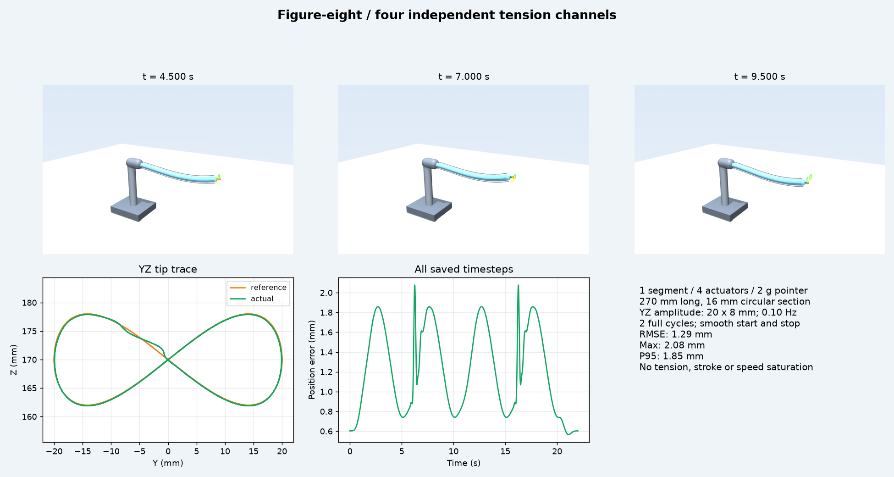
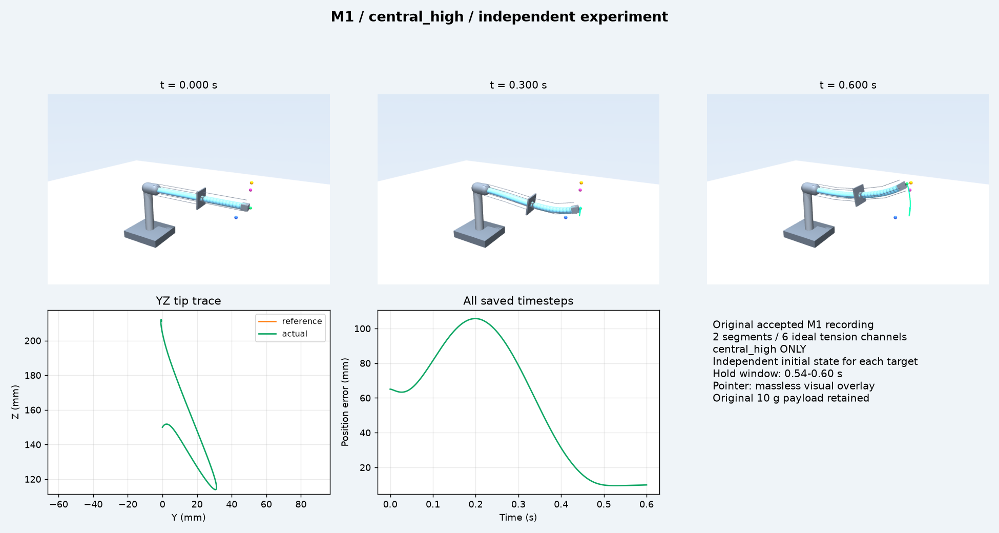
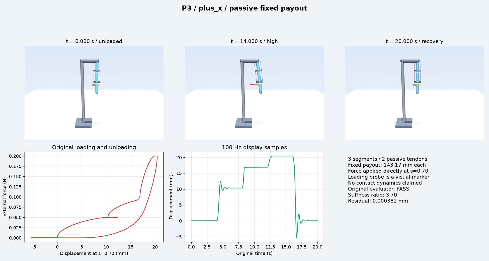

# Softrobot Demo Showcase

三个可独立启动的软体机器人仿真展示。原成果目录与生产工具源码保持只读；不启动 Main、Reporter、真实 Provider 或 Benchmark Harness。

## 启动

Python 3.11+，Windows/OpenGL。首次安装：

```powershell
cd D:\softrobot-demo-showcase
python -m venv .venv
.\.venv\Scripts\python.exe -m pip install -r requirements.txt
```

当前工作区已安装独立 `.venv`。每个 Demo 一条命令：

```powershell
# M1：三次独立实验，每次只播放一个。0.2 倍速便于观察最后 60 ms 保持阶段。
.\.venv\Scripts\python.exe .\viewer\showcase.py m1 --case central_high --speed .2
.\.venv\Scripts\python.exe .\viewer\showcase.py m1 --case positive_high --speed .2
.\.venv\Scripts\python.exe .\viewer\showcase.py m1 --case negative_low --speed .2

# 新任务：完整 22 s 的两周期 8 字
.\.venv\Scripts\python.exe .\viewer\showcase.py eight

# P3：原始正向或负向加载、卸载记录
.\.venv\Scripts\python.exe .\viewer\showcase.py p3 --case plus_x
.\.venv\Scripts\python.exe .\viewer\showcase.py p3 --case minus_x
```

也可用 `./scripts/run_demo.ps1 -Demo eight`（参数：`-Case`、`-Speed`、`-Loop`、`-Technical`）。播放器使用保存时间戳检索状态，仅调用 `mj_forward`，没有动力学积分。空格暂停，R 重播，L 循环，+/- 改变速度，1/2/3 切换总览、YZ 正视、侧视相机。`--technical` 隐藏附加外皮与基座，保留原结构和腱路。循环末尾冻结最终帧 2 秒只是展示停留，不延长已验证保持时间。

## 任务与结果

| Demo | 结构 / 执行器 | 结果与范围 |
|---|---|---|
| M1 Reach/Hold | 原 160 + 110 mm 两段，各 12 cells；6 根独立理想张力腱；原 10 g 负载 | 直接复用原成功 XML、配置、控制、601 行完整逐步轨迹/工况；未重求解 |
| Figure-eight | 新 270 mm 单段，12 cells / 24 弯曲自由度；直径 16 mm 圆截面；4 根腱，偏心距 12 mm；2 g 指示探头 | 新建独立任务并求解；22,000 次物理积分完成两周期；所有任务约束通过 |
| P3 | 原三段结构与连接；2 根固定放绳被动腱，143.1667 mm/根；0 主动通道 | 直接复用 plus_x/minus_x 原设计和验收；未重求解或重积分 |

M1 目标（m）：central_high `(0.295, 0, 0.215)`；positive_high `(0.285, 0.035, 0.185)`；negative_low `(0.275, -0.040, 0.135)`。三个不同颜色目标同时可见，但每次命令仅播放一个独立初态实验，未验证连续三目标切换。全物理步复查最后 `[0.54, 0.60] s` 保持窗口：

| M1 工况 | 最大保持误差 mm | 最大保持 Tip 速度 mm/s |
|---|---:|---:|
| central_high | 9.900 | 29.700 |
| positive_high | 9.678 | 29.700 |
| negative_low | 8.726 | 29.120 |

8 字参考为竖直 YZ 平面：`x=0.282`，`y=0.020 sin(phase)`，`z=0.170+0.008 sin(2 phase)`，单位 m。中间恒定频率 0.10 Hz，起止各 2 s 采用五次 smoothstep 角速度坡道，其积分恰好完成两个周期，总长 22 s。初始状态是带预张力的已求解平衡态，速度为零；不声称验证了从未加载直臂自动进入该初态。

采用生产代码 `extensions.tendon_family.compiler.resolve` 和 `mjcf.compile_xml` 生成结构，SciPy 有限次数静态平衡/最小二乘求周期张力，再通过周期三次样条前馈在 MuJoCo 3.13.0 中执行。单段材料参数 `E=4 MPa`、`rho=1050 kg/m³`，每 cell 弯曲阻尼 `0.025 N·m·s/rad`。没有给末端施加代替执行器的外力。

| 新 8 字全程指标 | 值 |
|---|---:|
| Tracking RMSE | 1.286 mm |
| 最大误差 | 2.076 mm |
| P95 误差 | 1.852 mm |
| 参考周期完成数 / 持续时间 | 2 / 22 s |
| 两周期相同相位最大位置差 | 0.702 mm |
| 停止时末端速度 | 0.083 mm/s |
| 张力饱和占比（各通道） | 0% |
| 接触数 / 求解器警告 | 0 / 0 |

两次实际运动均到达约 Y = ±19.93 mm、Z = 161.89–177.92 mm，均覆盖两个叶瓣；周期完成判断同时检查实际轨迹范围。

完整实际状态/参考：`figure_eight_tracking/trajectory_full.npz`，包含 22,001 个状态（初态 + 每 1 ms 积分后的状态）、qpos/qvel、各腱张力/长度和实际/参考 XYZ；`trajectory.csv` 提供同一完整时间网格的实际/参考 XYZ 与误差；`feedforward.npz` 保存周期控制节点和静态平衡状态。

| 8 字通道 | 最大张力 N | 所需行程 mm | 最大绳速 mm/s |
|---|---:|---:|---:|
| 0 | 4.262 | 3.065 | 1.511 |
| 1 | 4.262 | 3.065 | 1.511 |
| 2 | 5.903 | 1.216 | 0.765 |
| 3 | 2.297 | 1.216 | 0.765 |

任务限值：张力 0.2–8 N；总行程 30 mm；速度 30 mm/s；RMSE 3 mm；最大误差 6 mm；周期间偏差 2 mm。速度和行程按整个运行检查。所有主动通道（含 M1 六通道）的需求详见 [ACTUATOR_REQUIREMENTS.md](ACTUATOR_REQUIREMENTS.md) 和 `verification.json`。这是名义仿真的绳端需求，未选择电机型号。

P3 保留原低/中/高载及卸载工况，载荷 0.05 / 0.10 / 0.20 N。正负加载原验收均 PASS：位移约 10.346 / 16.906 / 20.454 mm；后/前区间刚度比 3.699；卸载残余约 0.000382 mm。保留原 `original_result.json`，不把粗离散模型等同于连续体精度证明。

## 展示与制造范围

统一场景有灰色底座/支撑柱/根部固定座，浅蓝柔性段与可辨认连接，灰色腱路，橙色参考与绿色实际轨迹。M1 与 8 字显示目标/实际坐标、误差、尾迹；8 字另有 YZ 同步轨迹图。P3 采用顶部支撑，金色 s=0.70 施力点、灰色加载杆、红色外力箭头、阶段文字和同步力—位移曲线。加载杆是视觉标记，原模型直接施加外力，未建立压头接触动力学。

M1 指示杆/球头仅为无质量无碰撞视觉标记，原 10 g 负载的质量、COM、惯量和碰撞几何保留。8 字探头是实际 2 g 刚体，COM `[7,0,0] mm`、对角惯量 `[1e-8,4e-8,4e-8] kg·m²`，有对应短杆/球头几何。P3 保留原物理负载，加载器仅作为动态绘制的视觉几何。

8 字四执行器方案与 P3 被动方案优先作为真机设计候选；M1 六腱快速运动优先用于仿真展示（逐通道绳速峰值可达约 105 mm/s）。现有模型均未验证摩擦、轴向压缩、材料非线性、导向件质量、制造公差或真实电机动态；不直接将理想张力序列下发硬件。8 字的密集导向需要在实体外皮中实现，其附加质量需要后续标定。

## 文件与数据

```text
M1_reach_hold/                 原 XML/结构 + scene.xml，三个独立工况
figure_eight_tracking/         新设计/任务/XML/完整轨迹/控制节点/结果
P3_progressive_stiffness/      原设计/任务/结果 + 正负加载展示采样
viewer/showcase.py            唯一通用播放器与预览入口
scripts/run_demo.ps1          统一启动包装
scripts/solve_figure_eight.py  生产生成器 + 数学求解 + 完整动力学执行
scripts/prepare_showcase.py   附加视觉 XML 和 P3 展示采样
scripts/verify_showcase.py    必要的状态和物理一致性检查
previews/                     各工况三个代表姿态与结果曲线
verification.json             最小检查和驱动需求
provenance.json               数据来源与复用范围
```

P3 每个原始工况 160,000 个物理步（0.125 ms），此仓库只保存 2,005 个展示状态：每 80 行一采样，加阶段边界和首末状态，保留原始时间戳。`display_replay.npz` 明确是约 100 Hz 展示数据，不冒充全物理步记录。原完整轨迹仍在 `D:\softrobot-benchmark-exports\base_only_accepted_20261028\P3_passive_progressive_stiffness\cases`。M1 与新 8 字保留完整逐步数据。未复制完整原始档案；可选 PHS2D 本轮跳过。

复现检查 / 渲染示例：

```powershell
.\.venv\Scripts\python.exe .\scripts\verify_showcase.py
.\.venv\Scripts\python.exe .\viewer\showcase.py eight --render .\previews\figure_eight.png
```

仅在需要重新求解时使用 `scripts/solve_figure_eight.py`；这会更新新 8 字结果。生成结构需要只读生产仓库及其依赖（可用现有 `.mainline5-env` 环境）；`SOFTROBOT_CORE` 可指定生产仓库位置，默认 `D:\softrobot-agent-core`。回放不依赖该仓库或原成果目录。`prepare_showcase.py` 重建展示 XML/采样时需要原成果目录。

最小验证已通过：M1 3×601、8 字 22,001、P3 2×2,005 个保存姿态全部恢复一致；附加场景与物理基线的质量/COM/惯量、关节、碰撞和腱路保持一致；全程跟踪与驱动约束通过；三个 Demo GUI 冒烟回放通过；每个工况三姿态预览已人工视觉检查，无明显显示缺失或异常。验证播放器零物理积分，未重跑 M1/P3。





Public 仓库：[wran021004-gif/softrobot-demo-showcase](https://github.com/wran021004-gif/softrobot-demo-showcase)。工作分支：[codex/showcase-design-solve-20261111](https://github.com/wran021004-gif/softrobot-demo-showcase/tree/codex/showcase-design-solve-20261111)。
